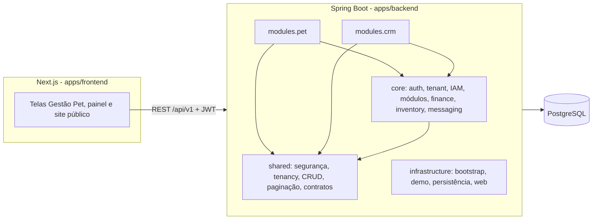

# Arquitetura da Plataforma

Data de referência: 2026-10-31. Todas as afirmações deste documento foram conferidas contra o código nessa data; caminhos de classe são relativos a `apps/backend/src/main/java/com/phaiffertech/platform`.

## Visão geral

A plataforma é um **monólito modular multi-tenant**: um único backend Spring Boot e um único banco PostgreSQL com schema compartilhado, em que cada linha de negócio carrega `tenant_id`. O produto em foco é o **Gestão Pet** para banho e tosa; o módulo de CRM existe como apoio (tarefas, notas e atividades) e o código clínico veterinário é preservado, mas fica oculto no plano de banho e tosa.

Por que monólito modular e não microsserviços: um único deploy reduz custo operacional e complexidade de consistência transacional (fatura, pagamento, estoque e sessões de plano mudam na mesma transação), enquanto a divisão por pacotes preserva fronteiras de domínio que permitem extrair serviços no futuro, se houver necessidade real.

## Organização do backend

| Pacote | Responsabilidade |
| --- | --- |
| `shared` | Infraestrutura técnica sem regra de negócio: `security`, `tenancy`, `crud`, `pagination`, `response`, `exception`, `ratelimit`, `metrics`, `logging`, `health`, `contracts`, `dashboard` (DTOs), `usage`, `web` |
| `core` | Capacidades de plataforma: `auth`, `tenant`, `user`, `iam`, `module`, `settings`, `audit`, `notification`, `attachment`, `subscription`, `finance`, `inventory`, `messaging` |
| `modules.pet` | Domínio Gestão Pet: `client`, `petprofile`, `appointment`, `servicecatalog`, `professional`, `commission`, `plan`, `product`, `inventory`, `invoice`, `billing`, `dashboard`, `capability`; e o código clínico/adjacente `medical`, `subscription`, `portal` |
| `modules.crm` | Empresas, contatos, leads, negócios, pipeline, tarefas, notas, atividade e dashboard |
| `infrastructure` | `bootstrap` (admin master), `demo` (ambiente comercial de demonstração), `persistence` (seed de desenvolvimento), `docs` (OpenAPI), `web`, `notification` |

### Regras de dependência

- `core` e `shared` não importam classes de `modules.*`.
- Um módulo vertical não importa outro (`modules.pet` ↔ `modules.crm`).
- Agregações entre módulos passam por contratos em `shared.contracts`, como `ModuleSummaryCapability`, implementado por `modules.pet.capability.PetDashboardCapability` e `modules.crm.capability.CrmDashboardCapability` e consumido por `core.module.service.PlatformDashboardService`.

Em 2026-10-31 não há nenhuma violação dessas regras no código (verificado por busca de imports). Elas são mantidas por convenção e revisão; ainda não existe teste automatizado de arquitetura (por exemplo, ArchUnit) que as garanta.

## Multi-tenancy

- `shared.tenancy.TenantContext` guarda o tenant ativo durante a requisição.
- `shared.tenancy.TenantContextFilter` valida o tenant informado contra o tenant do usuário autenticado; acesso cruzado é rejeitado com `403`.
- Repositórios e serviços de negócio filtram sempre por `tenant_id`. A camada `shared.crud` (`BaseTenantCrudService` e afins) concentra esse comportamento para os CRUDs comuns.
- Cada tenant tem plano comercial e *entitlements* (`pet.aesthetics`, `pet.clinic`, `pet.retail`, `pet.veterinary`, `crm.basic` etc.). O frontend usa os entitlements para decidir quais telas aparecem (`apps/frontend/src/shared/entitlements/tenant-entitlements.ts`); é assim que as telas clínicas ficam ocultas no plano de banho e tosa.

## Segurança e autorização

Modelo de dados: `users` (identidade global), `tenants`, `user_tenants` (vínculo), `user_tenant_roles`, `roles`, `permissions` e `role_permissions`.

Fluxo:

1. O login identifica usuário e tenant.
2. O backend resolve papéis do vínculo usuário-tenant e agrega as permissões.
3. O JWT de acesso carrega `user_id`, `tenant_id`, papéis e permissões.
4. Cada endpoint exige a permissão adequada via `@RequirePermission` (`shared.security.RequirePermission`), por exemplo `pet.appointment.update`.

Três condições independentes controlam o acesso a um módulo:

| Condição | Escopo | Onde fica | Pergunta |
| --- | --- | --- | --- |
| Módulo habilitado | tenant | `tenant_modules` | O tenant contratou o módulo? |
| Feature flag | rollout | `feature_flags` | A funcionalidade está liberada agora? |
| Permissão | usuário | JWT + `role_permissions` | Este usuário pode fazer esta ação? |

`core.module.service.ModuleAccessService` combina as duas primeiras e `shared.security.ModuleAccessGuard` bloqueia `/api/v1/pet/**` e `/api/v1/crm/**` quando o módulo não está disponível. No frontend, o menu lateral e os guards de rota usam a mesma informação.

Outros controles:

- **Refresh token**: apenas o hash SHA-256 é armazenado (`refresh_tokens.token_hash`); há rotação a cada renovação e revogação no logout.
- **Recuperação de senha**: tokens de uso único com expiração (padrão de 30 minutos no profile `dev`).
- **Rate limiting** (Bucket4j, `shared.ratelimit.ApiRateLimitFilter`): 10 req/min nos endpoints de autenticação e 100 req/min no restante da API, configuráveis por `APP_RATE_LIMIT_*`.
- **Auditoria**: ações de autenticação e escrita geram registros em `audit_logs` via `@AuditableAction`.
- **Impersonação de suporte**: sessões explícitas e auditadas para o time de suporte entrar em um tenant, com banner visível no frontend.
- **Segredos de integração**: tokens de canais de mensageria são cifrados antes de persistir (`core.messaging.service.SecretCipherService`).

## Persistência

- PostgreSQL 16 com schema evoluído exclusivamente por migrações Flyway incrementais em `apps/backend/src/main/resources/db/migration` (72 versões em 2026-10-31). Migrações publicadas nunca são editadas; correções entram como nova versão.
- Entidades de negócio usam *soft delete* (`deleted_at`) e várias têm endpoint de restauração.
- Contrato de paginação padrão: parâmetros `page`, `size`, `sort`, `direction`, `search`; resposta com `items`, `page`, `size`, `totalItems`, `totalPages` (`shared.pagination.PageResponseDto`).
- Algumas migrações antigas criaram tabelas de um módulo de IoT que foi removido do produto. Elas permanecem na cadeia para não quebrar bancos já migrados, mas nenhum código atual depende delas.

## Domínio Gestão Pet

Detalhes de entidades e regras em [domain/grooming-domain.md](domain/grooming-domain.md). Principais tabelas:

| Conceito | Tabelas |
| --- | --- |
| Clientes e pets | `pet_clients`, `pet_profiles` |
| Catálogo e equipe | `pet_services` (flags de plano, avulso e comissão), `pet_professionals` (taxa de comissão opcional) |
| Atendimento | `pet_appointments` e `pet_appointment_services` (linhas multi-serviço com preço, profissional e snapshot de comissão) |
| Planos | `pet_plan_templates`, `pet_client_plans` (sessões totais, usadas e restantes) |
| Estoque | `inventory_items`, `inventory_movements` (core), `pet_service_inventory_links` (consumo esperado), `pet_appointment_service_inventory` (consumo real) |
| Cobrança | `finance_invoices`, `finance_payments`, `finance_cash_movements`, `finance_payment_events` (core) e `pet_invoices` (vínculo com cliente, pet e atendimento) |
| Mensagens | `pet_billing_message_settings` e as tabelas de `core.messaging` |

Fluxos centrais:

- **Atendimento multi-serviço**: cada linha guarda serviço, preço, profissional e a elegibilidade/taxa de comissão vigente no momento, para que o fechamento não mude quando o cadastro mudar.
- **Plano e sessões**: concluir um atendimento vinculado a um plano consome uma sessão; o painel destaca planos na penúltima e na última sessão.
- **Estoque**: o consumo real é registrado por linha de atendimento e a baixa é uma ação explícita do operador, não automática.
- **Cobrança a partir do atendimento**: o atendimento guarda o `invoiceId` da fatura gerada, o que permite reabrir a cobrança depois.

## Pagamentos

A cobrança é uma capacidade genérica de `core.finance`, independente do meio de pagamento:

- `finance_invoices` → `finance_payments` → `finance_cash_movements` representam o que é devido, o que foi pago e o reflexo no caixa.
- `core.finance.payment.provider.PaymentProvider` é a porta para provedores. Hoje existem `ManualPaymentProvider` (confirmação manual pelo operador) e `NoopPaymentProvider`, resolvidos por `PaymentProviderRegistry`.
- `finance_payment_events` registra eventos de pagamento com chave de idempotência única por tenant e provedor (`uq_finance_payment_events_tenant_provider_idempotency`), base para webhooks idempotentes quando houver um provedor externo.

Não há gateway PIX ou cartão integrado; os dados de PIX aparecem como texto nas mensagens. A evolução planejada está em [payments/payment-roadmap.md](payments/payment-roadmap.md).

## Mensageria

Duas camadas separadas:

1. **Mensagens preparadas (fluxo validado)**: `modules.pet.billing` monta o texto de retirada do pet e de renovação de plano a partir de cliente, pet, atendimento, plano e fatura; o frontend exibe e copia o texto para envio manual.
2. **Fundação WhatsApp Cloud API**: `core.messaging` tem configuração de canal, registro de envios (`message_dispatches`), eventos de entrega e webhook de verificação/recebimento, atrás da interface `MessageProvider`. O envio oficial não está validado por depender de liberação de cobrança da Meta.

A mensageria fica no core, e não no domínio pet, para que outros módulos possam enviar mensagens sem acoplar o WhatsApp ao atendimento.

## Dashboards

- `GET /api/v1/dashboard/summary`: painel da plataforma, agregado por `PlatformDashboardService` a partir das `ModuleSummaryCapability` que o usuário pode ver.
- `GET /api/v1/pet/dashboard/summary` e `GET /api/v1/crm/dashboard/summary`: painéis operacionais, cada um construído pelo próprio módulo.
- Os DTOs de cartões, métricas, listas e séries ficam em `shared.dashboard.dto`, e os componentes visuais correspondentes em `apps/frontend/src/shared/dashboard`.

## Frontend

- Next.js App Router com grupos de rota `(public)` (site institucional, login e recuperação de senha) e `(app)` (área autenticada; telas Gestão Pet em `/pet/*`).
- As telas ficam em `apps/frontend/src/modules/<domínio>` e os componentes compartilhados em `apps/frontend/src/shared`.
- Proteção em camadas: rota autenticada, `ModuleGuard` (módulo disponível), verificação de permissões e de entitlements.
- **Internacionalização**: pt-BR (padrão) e en-US. Todos os textos das telas de banho e tosa vêm de catálogos tipados (`shared/i18n/messages`); erros da API são exibidos traduzidos em pt-BR. Convenções em [apps/frontend/README.md](../apps/frontend/README.md).

## Observabilidade

- Logs JSON (Logback) com `trace_id`, `span_id`, `tenant_id` e `user_id` no MDC.
- Métricas Micrometer expostas em `/actuator/prometheus`, incluindo `auth.attempts`, `crm.contacts.created`, `pet.appointments.created`, `platform.api.requests`, `platform.audit.events` e `platform.usage.events`.
- Tracing via ponte Micrometer/OpenTelemetry.
- `/actuator/health` com indicadores de banco e de estado das migrações Flyway.
- Stack local opcional com Prometheus, Grafana e Loki (`make observability-up`).

## Testes e entrega

- Backend: testes unitários e de integração com Testcontainers (PostgreSQL real), cobrindo autenticação, isolamento entre tenants, permissões, CRUDs e os fluxos de pet e finance.
- Frontend: Vitest + Testing Library para componentes e utilitários.
- CI (`.github/workflows/ci.yml`): `mvn clean verify` e `npm ci && npm test && npm run lint && npm run build` em cada PR.
- Deploy (`backend-deploy.yml`, `frontend-deploy.yml`): imagens no Artifact Registry e serviços no Cloud Run, com infraestrutura em `infra/gcp/terraform` (Cloud SQL, Secret Manager, contas de serviço com IAM mínimo). Detalhes em [platform/gcp-minimal-infra.pt-BR.md](platform/gcp-minimal-infra.pt-BR.md).

## Limitações atuais

- WhatsApp oficial não validado; a demo usa mensagens preparadas.
- Sem gateway de pagamento integrado.
- Fronteiras entre módulos sem teste automatizado de arquitetura.
- Telas de CRM, clínica e administração ainda sem internacionalização completa.
